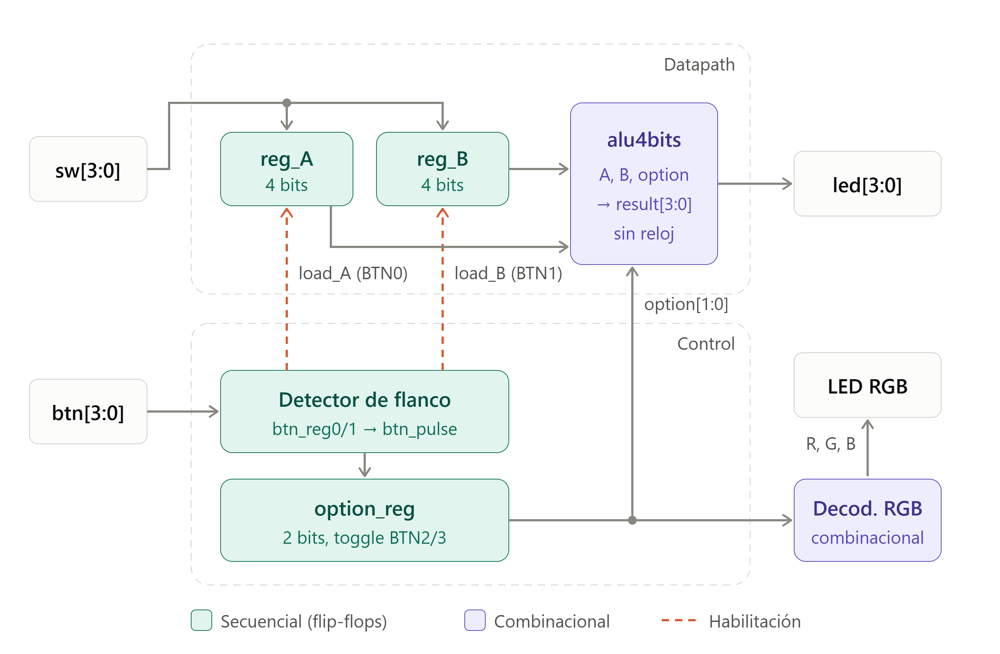
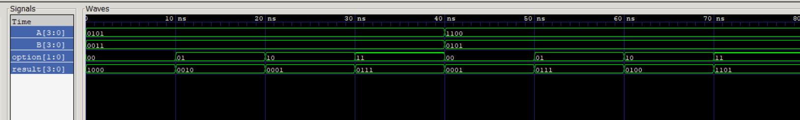
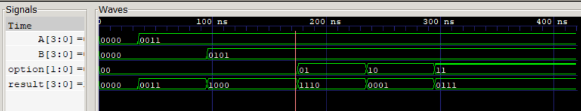

# Laboratorio 02: Diseño, simulación e implementación de una ALU de 4 bits

---

## Integrantes

- Laura Alejandra Moreno
- Jana Rubiano Hurtado
- Johana Tellez Gamez
- Alina Idaly Ortíz Martinez

**Semestre:** 2026-1  

---

## Índice

- [Explicación General del Sistema](#explicación-general-del-sistema)
- [Arquitectura Propuesta](#arquitectura-propuesta)
- [Módulos Desarrollados](#módulos-desarrollados)
- [Operaciones e Interfaz](#operaciones-e-interfaz)
  - [Tabla de Operaciones Implementadas](#tabla-de-operaciones-implementadas)
  - [Identificación Visual mediante LED RGB](#identificación-visual-mediante-led-rgb)
- [Gestión de Operandos y Código de Operación](#gestión-de-operandos-y-código-de-operación)
  - [Almacenamiento de Operandos](#almacenamiento-de-operandos)
  - [Conservación del Código de Operación](#conservación-del-código-de-operación)
- [Simulación y Verificación](#simulación-y-verificación)
  - [Capturas de GTKWave](#capturas-de-gtkwave)
  - [Explicación del Comportamiento Observado](#explicación-del-comportamiento-observado)
- [Implementación Funcional en FPGA](#implementación-funcional-en-fpga)
- [Conclusiones](#conclusiones)
- [Referencias](#referencias)

---

## Explicación General del Sistema

### Propósito general del diseño
El presente diseño consiste en el desarrollo e implementación de una Unidad Aritmético-Lógica (ALU) de 4 bits, la cual constituye el primer bloque funcional del *datapath* de un procesador digital. El propósito principal del sistema es ejecutar operaciones aritméticas (suma y resta) y lógicas (AND y OR) utilizando lógica puramente combinacional. Para lograr esto, el diseño separa estrictamente la ejecución de las operaciones (realizadas por la ALU) del almacenamiento de los datos y estados (gestionado por registros externos).

### Funcionamiento global
Dado que los recursos físicos de entrada son limitados, el sistema emplea una arquitectura de bus de datos compartido. El flujo de funcionamiento global mediante las entradas de la FPGA permiten  al usuario ingresar los operandos de forma secuencial y almacenarlos en registros independientes (Registro A y Registro B)  lo cual se realiza dentro del módulo principal. De manera paralela, el sistema cuenta con un registro de control de 2 bits que conserva el código de la operación seleccionada (00, 01, 10 u 11) regida por los botones de la FPGA. Una vez almacenados los operandos y definida la operación, la ALU procesa los datos de manera combinacional y continua. El sistema está diseñado para mantener en memoria los valores ingresados y la operación activa incluso después de soltar los botones de control o modificar el bus de datos, actualizando el resultado únicamente cuando el usuario decide cambiar explícitamente algún operando o el código de operación.

### Interacción con las entradas y salidas de la FPGA
La interacción del usuario con el sistema se realiza de forma directa a través de los periféricos físicos de la tarjeta FPGA , distribuidos de la siguiente manera:

* **Entradas de datos (Switches SW0 a SW3):** Actúan como un bus de datos de 4 bits a través del cual el usuario configura el valor binario del operando que desea ingresar al sistema.
* **Entradas de control (Botones BTN0 a BTN3):** Permiten al usuario manejar el flujo de datos. El botón **BTN0** captura el valor actual de los switches y lo guarda como Operando A, mientras que el **BTN1**  guarda  el valor como Operando B. Por su parte, los botones **BTN2** y **BTN3** funcionan como selectores de operación al invertir  de forma individual los bits 0 y 1 del registro del código de operación.
  
* **Salidas de datos (LEDs estándar LED0 a LED3):** Se utilizan para visualizar en tiempo real el resultado de 4 bits de la operación matemática o lógica procesada por la ALU.
* **Salida de estado (LED RGB):** Proporciona información al usuario acerca de  qué operación se está ejecutando actualmente en el sistema. Emite luz de color **Verde** para la suma, **Rojo** para la resta, **Azul** para la operación AND, y **Amarillo** (combinación de rojo y verde) para la operación OR.
---

## Arquitectura Propuesta

El diseño se fundamenta en una arquitectura que divide el sistema en una ruta de datos (*datapath*) y una unidad de control. Esta separación garantiza que la ejecución de las operaciones aritmético-lógicas (lógica combinacional) sea completamente independiente de la captura y almacenamiento de datos del usuario (lógica secuencial).

### Diagrama de bloques
 

 
**Figura 1.** Diagrama de bloques del datapath y la unidad de control. Los switches comparten un bus que se captura en `reg_A` y `reg_B` mediante pulsos de un ciclo; la ALU es puramente combinacional.
 
### Datapath y registros de entrada

La ruta de datos relaciona  la información desde los periféricos físicos hasta las salidas visuales:

- **Bus de datos multiplexado:** los cuatro interruptores físicos de la FPGA (`sw[3:0]`) funcionan como un bus de entrada compartido en el tiempo.

- **Registros de operandos:** se implementaron dos registros de 4 bits (`reg_A` y `reg_B`) utilizando memoria secuencial usando flip-flops sincronizados con la señal `clk`. Estos registros actúan como memorias de entrada que capturan el valor del bus temporalmente, reteniendo los operandos estables frente a la ALU de forma continua, sin importar si los interruptores cambian de posición posteriormente.

### Unidad de control
 
Se encarga de gobernar el flujo de captura de datos y de seleccionar la operación a través de los botones físicos (`btn[3:0]`). Detecta el flanco de subida de cada botón para generar un pulso de un ciclo de reloj que habilita la escritura en los registros. Un registro de operación (`option_reg`) conserva el código seleccionado y alimenta tanto a la ALU como al decodificador del LED RGB.
 
- **Acondicionamiento de señal (detector de flanco):** la señal de los botones se hace pasar por un par de registros de desplazamiento (`btn_reg0` y `btn_reg1`) y se calcula `btn_pulse = btn_reg0 & ~btn_reg1`. Esto extrae un pulso limpio de un solo ciclo de reloj en el flanco de subida, de modo que una pulsación sostenida produce una única acción. Dicho pulso se usa como habilitador para la escritura segura en los registros.
- **Registro de instrucción (opcode):** un registro de control de 2 bits (`option_reg`) almacena la operación elegida. En lugar de requerir que el usuario mantenga el botón presionado, la unidad de control invierte cada bit individualmente mediante los pulsos de `BTN2` (bit 0) y `BTN3` (bit 1), actuando como una memoria de estado.

## Módulos Desarrollados


El diseño consta de dos módulos de diseño en Verilog, ubicados en la carpeta `src/`, y un testbench ubicado en `sim/`:
 
- **`top.v` (módulo superior):** actúa como interfaz con el hardware de la FPGA. Contiene la lógica secuencial (registros de operandos, registro de operación y detector de flanco de los botones), instancia la ALU y decodifica el código de operación para encender el LED RGB correspondiente.
- **`alu4bits.v` (módulo ALU):** núcleo de procesamiento, puramente combinacional. Recibe los operandos `A` y `B` de 4 bits y el código `option` de 2 bits, y selecciona mediante una cadena de operadores condicionales el resultado de la operación pedida.
- **`tb_alu.v` (testbench, en `sim/`):** aplica distintas combinaciones de operandos y las cuatro operaciones, y genera el archivo de ondas `alu_wave.vcd` para GTKWave.
- **`tb_top.v` (testbench, en `sim/`):** simula el comportamiento global del sistema, incluyendo la pulsación de los botones, el almacenamiento correcto en los registros y el cambio de colores del LED RGB.
### `alu4bits.v`
 
```verilog
`timescale 1ns / 1ps
 
module alu4bits (
    input  wire [3:0] A,
    input  wire [3:0] B,
    input  wire [1:0] option,
    output wire [3:0] result
);
 
    assign result = (option == 2'b00) ? (A + B) :
                    (option == 2'b01) ? (A - B) :
                    (option == 2'b10) ? (A & B) :
                    (option == 2'b11) ? (A | B) :
                    4'b0000;
 
endmodule
```
 
El módulo no contiene reloj ni registros: usa únicamente una asignación continua (`assign`), por lo que el resultado depende solo de los valores actuales de `A`, `B` y `option`. La suma y la resta se realizan sobre 4 bits, es decir, módulo 16. Por ejemplo, $12 + 5 = 17$ se muestra como $1$ y $3 - 5$ como $14$ (`1110`). La rama final (`4'b0000`) cubre los casos no definidos y, con un `option` de 2 bits, nunca se alcanza.

 
## Operaciones e Interfaz

### Tabla de Operaciones Implementadas
 
A continuación se detallan las operaciones soportadas según el código de operación (*OpCode*) de 2 bits:
 
| Código de Operación (`option`) | Operación | Expresión en Verilog | Explicación |
| :---: | :---: | :---: | :--- |
| `00` | Suma | `A + B` | $R = A + B \pmod{16}$ |
| `01` | Resta | `A - B` | $R = A - B \pmod{16}$ |
| `10` | AND | `A & B` | $R = A \ \& \ B$ |
| `11` | OR | `A \| B` | $R = A \ \vert \ B$ |
 
### Asignación de Hardware
 
| Recurso | Señal en `top` | Función |
| :--- | :---: | :--- |
| Switches | `sw[3:0]` | Bus de datos de 4 bits |
| BTN0 | `btn[0]` | Cargar Operando A |
| BTN1 | `btn[1]` | Cargar Operando B |
| BTN2 | `btn[2]` | Invertir bit 0 del código de operación |
| BTN3 | `btn[3]` | Invertir bit 1 del código de operación |
| LEDs | `led[3:0]` | Resultado de la operación |
| LED RGB | `red`, `green`, `blue` | Operación seleccionada |
 
### Identificación Visual mediante LED RGB
 
Un bloque de lógica combinacional analiza el valor de `option_reg` y lo decodifica para activar los canales del LED RGB. Se activan dos canales a la vez (rojo + verde) para generar el color amarillo:
 
| Operación | Código (`option`) | Estado LED RGB (R, G, B) | Color Resultante |
| :--- | :---: | :---: | :--- |
| **Suma** | `00` | `(0, 1, 0)` | Verde |
| **Resta** | `01` | `(1, 0, 0)` | Rojo |
| **AND** | `10` | `(0, 0, 1)` | Azul |
| **OR** | `11` | `(1, 1, 0)` | Amarillo |
 

## Gestión de Operandos y Código de Operación


### Almacenamiento de Operandos
 
Los operandos se almacenan en dos registros de 4 bits (`reg_A` y `reg_B`) implementados con flip-flops sincronizados con la señal `clk`. La señal de cada botón pasa por dos registros (`btn_reg0` y `btn_reg1`) y el pulso se obtiene como `btn_pulse = btn_reg0 & ~btn_reg1`, que vale 1 durante un solo ciclo de reloj en el flanco de subida. Ese pulso actúa como habilitador de escritura:
 
- `btn_pulse[0]` guarda el valor actual de `sw` en `reg_A`.
- `btn_pulse[1]` guarda el valor actual de `sw` en `reg_B`.
Fuera de esos pulsos, los registros mantienen su valor, por lo que los operandos permanecen estables frente a la ALU aunque los switches cambien de posición.
 
### Conservación del Código de Operación
 
El registro de control `option_reg` (2 bits) actúa como memoria de estado para conservar la operación. En lugar de requerir que el usuario mantenga presionado un botón, cada pulso invierte (*toggle*) un bit del código:
 
- Un pulso en **BTN2** invierte el bit 0: `option_reg[0] <= ~option_reg[0]`.
- Un pulso en **BTN3** invierte el bit 1: `option_reg[1] <= ~option_reg[1]`.
Así, el código permanece almacenado y la ALU procesa la operación elegida de forma continua hasta que se vuelva a presionar alguno de estos botones. El estado inicial es `00` (suma), definido en la inicialización del registro.
 
Dado que el LED RGB se decodifica directamente desde `option_reg`, el color mostrado corresponde en todo momento al código almacenado.

---
## Simulación y Verificación

### Capturas de GTKWave


**Figura 2.** Formas de onda del testbench de la ALU (`tb_alu.v`), demostrando el procesamiento puramente combinacional.


**Figura 3.** Formas de onda del testbench del módulo superior (`tb_top.v`), mostrando la carga secuencial de operandos y la ejecución de operaciones.

---

### Explicación del Comportamiento Observado

### Explicación del Comportamiento Observado

* **Comportamiento combinacional de la ALU (`alu4bits`):**  
  La simulación confirma la naturaleza puramente combinacional del módulo: la salida `result` se actualiza de manera instantánea ante cambios en las entradas o en el selector `option`, sin depender de una señal de reloj.  
  Con los operandos iniciales $A = 0101_2$ (5) y $B = 0011_2$ (3), se validaron con éxito las cuatro operaciones: suma (`1000` = 8), resta (`0010` = 2), AND (`0001`) y OR (`0111`). Al evaluar el segundo caso con $A = 1100_2$ (12) y $B = 0101_2$ (5), se evidenció el correcto truncamiento de 4 bits ante desbordamiento en la suma ($12 + 5 = 17 \rightarrow \text{`0001`}$), así como la exactitud en la resta (`0111` = 7), AND (`0100`) y OR (`1101`).

* **Captura de operandos en el módulo superior (*Top-Level*):**  
  Se validó el almacenamiento secuencial de datos en los registros internos mediante el accionamiento de los pulsadores. Se observa una carga ordenada: primero se capturó el operando $A$ con el valor `0011` (3) y posteriormente el operando $B$ con `0101` (5). Dado que la operación por defecto es la suma (`option = 00`), el circuito mantuvo la salida reflejando el valor de $A$ hasta que se ingresó $B$, momento en el cual el resultado convergió de inmediato a `1000` (8).

* **Operaciones en complemento a dos y retención de registros:**  
  Al conmutar las señales de control en el sistema integrado, se comprobó el soporte de aritmética con signo: la resta $3 - 5 = -2$ se codificó fielmente en complemento a dos como la palabra binaria `1110`. Finalmente, las transiciones hacia las funciones lógicas AND (`10` $\rightarrow$ `0001`) y OR (`11` $\rightarrow$ `0111`) confirmaron que los registros internos retienen intactos los operandos $A$ y $B$, demostrando la correcta independencia entre la lógica secuencial de almacenamiento y la etapa de cálculo combinacional.


  
## Implementación Funcional en FPGA

El funcionamiento del sistema fue verificado exitosamente sobre la tarjeta física FPGA. Para documentar este proceso, se grabó un video demostrativo donde se evidencia la correcta integración y ejecución de todos los módulos del diseño.


**Enlace al video demostrativo:** [Clic aquí para ver el video en Google Drive](https://drive.google.com/file/d/1d3GRg8ucuHWTD3ENBnNhpWm8ChCu8aBU/view?usp=drive_link)

En la demostración se puede observar cómo se ingresan los operandos a través del bus de switches y se almacenan de manera independiente utilizando los botones de carga, comprobando que los valores se conservan en la memoria interna aun cuando los switches cambian de posición. Asimismo, se valida el procesamiento continuo de la ALU al mostrar los resultados correctos en los LEDs de salida al alternar entre las operaciones de suma, resta (evidenciando el complemento a 2), AND y OR. Finalmente, el video comprueba que la operación seleccionada se mantiene activa sin necesidad de dejar presionados los botones, lo cual es indicado visualmente por el LED RGB, el cual ilumina de forma estable en los colores asignados (verde, rojo, azul y amarillo) según la instrucción actual.

## Conclusiones

- Principales aprendizajes del diseño digital con captura/almacenamiento de datos.
- Dificultades técnicas encontradas durante la simulación o la síntesis.
- Aportes del análisis de ondas en GTKWave para la detección de errores.

---

## Referencias

- Documentación oficial del lenguaje Verilog HDL.
- Especificaciones de la tarjeta FPGA empleada en el laboratorio.
