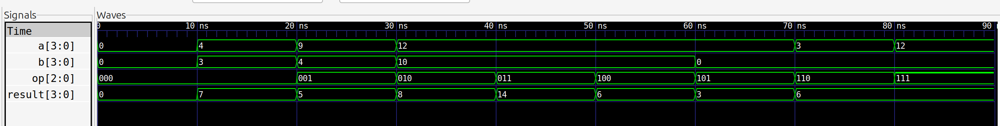
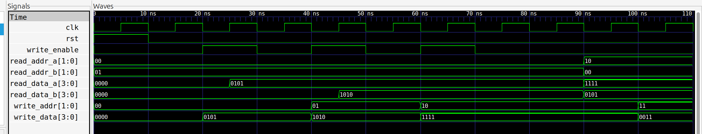
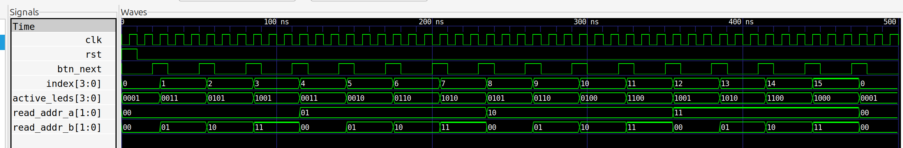

# Funcionamiendo de los módulos
## ALU

| Código de operación (SW\[2:0\]) | Operación | Expresión |
| --- | --- | --- |
| `3'b000` | Suma | $A + B$ |
| `3'b001` | Resta | $A - B$ |
| `3'b010` | AND bit a bit | $A \land B$ |
| `3'b011` | OR bit a bit | $A \lor B$ |
| `3'b100` | XOR bit a bit | $A \oplus B$ |
| `3'b101` | NOT bit a bit de A | $\sim A$ |
| `3'b110` | Desplazamiento lógico a la izquierda de A | $A \ll 1$ |
| `3'b111` | Desplazamiento lógico a la derecha de A | $A \gg 1$ |



## Banco de Registros

El Banco de Registros es un bloque de memoria de alta velocidad, está compuesto por cuatro celdas de almacenamiento ($R0, R1, R2, R3$). Su función es guardar operandos temporales y ponerlos a disposición de la ALU (Unidad Aritmético-Lógica).

### Funcionamiento 

1. Estructura interna (`registers`): Se declara una matriz de cuatro elementos, cada uno de 4 bits, mediante `reg [3:0] registers [0:3]`. Esto permite almacenar un total de 16 bits distribuidos en cuatro registros.

2. Escritura sincrónica (`write_enable`): Ocurre en el flanco de subida del reloj (`posedge clk`). Solo cuando `write_enable` está en `1`, se actualiza el registro seleccionado por `write_addr` con el valor presente en `write_data` (`SW[3:0]`).

3. Reinicio sincrónico o asincrónico (`rst`): Limpia las cuatro posiciones y las establece en `4'b0000` al iniciar el sistema. El comportamiento depende de cómo se implemente la señal de reinicio en el bloque de código:

- Sincrónico: el reinicio se ejecuta en el flanco de subida del reloj.
- Asincrónico: el reinicio se ejecuta inmediatamente cuando se activa la señal, independientemente del reloj.

4. Lectura asincrónica (`read_data_a` y `read_data_b`): Es puramente combinacional. Al cambiar la dirección de los selectores `read_addr_a` o `read_addr_b`, el dato almacenado se refleja inmediatamente en las salidas hacia la ALU, sin esperar un ciclo de reloj.



## Módulo Selector de Combinaciones 

El módulo Selector de Combinaciones (`comb_selector.v`) se encarga de cambiar dinámicamente las direcciones de los operandos $A$ y $B$, que se leen desde el banco de registros para enviarlos a la ALU.

### Funcionamiento

1. Índice interno (`index`): Es un contador de 4 bits que almacena el estado actual de la combinación seleccionada.

2. Avanzar combinaciones (`btn_next`): Cada vez que se presiona el botón `BTN2` (filtrado como un pulso de un ciclo de reloj), el contador `index` se incrementa en 1, recorriendo las 16 combinaciones posibles ($4 \times 4$ parejas de registros).

3. Mapeo de direcciones:

- `read_addr_a` toma los 2 bits más significativos del contador: `index[3:2]`.
- `read_addr_b` toma los 2 bits menos significativos del contador: `index[1:0]`.

4. Control de los LED de estado (`active_leds`): Activa en `1` los bits correspondientes a los registros seleccionados.

De esta forma, si $A = R0$ y $B = R1$, los bits 0 y 1 se encienden (`4'b0011`), activando `LED0` y `LED1` en la tarjeta.

| Pulsación (BTN2) | Contador `index` | Bits `[3:2]` (Operando A) | Bits `[1:0]` (Operando B) | Operandos seleccionados | LEDs encendidos (`active_leds`) |
| --- | --- | --- | --- | --- | --- |
| Inicio (Reset) | `0000` (0) | `00` (0) | `00` (0) | A = R0, B = R0 | LED0 encendido |
| 1.ª pulsación | `0001` (1) | `00` (0) | `01` (1) | A = R0, B = R1 | LED0 y LED1 encendidos |
| 2.ª pulsación | `0010` (2) | `00` (0) | `10` (2) | A = R0, B = R2 | LED0 y LED2 encendidos |
| 3.ª pulsación | `0011` (3) | `00` (0) | `11` (3) | A = R0, B = R3 | LED0 y LED3 encendidos |
| 4.ª pulsación | `0100` (4) | `01` (1) | `00` (0) | A = R1, B = R0 | LED1 y LED0 encendidos |
| ... | ... | ... | ... | ... | ... |
| 15.ª pulsación | `1111` (15) | `11` (3) | `11` (3) | A = R3, B = R3 | LED3 encendido |
| 16.ª pulsación | `0000` (0) | `00` (0) | `00` (0) | Vuelve a empezar: A = R0, B = R0 | LED0 encendido |




## Display TM1637
Como el resultado de la ALU es de 4 bits, su valor oscila entre 0 y 15 ($0000_2$ a $1111_2$).

## 1. Modo Binario (`mode_sel = 1`)

Cada uno de los 4 dígitos del display representa 1 bit del resultado.

- Ejemplo: Si el resultado es `4'b1101` ($13_{10}$), el display mostrará visualmente:

text
```
[ 1 ] [ 1 ] [ 0 ] [ 1 ]
```

## 2. Modo Decimal (`mode_sel = 0`)

Muestra el número en base 10 utilizando decenas y unidades en los dos dígitos de la derecha.

- Ejemplo: Si el resultado es 13, los dos primeros dígitos se apagan y los últimos muestran 13:

text
```
[   ] [   ] [ 1 ] [ 3 ]
```


## Módulo Anti-rebote
Se implementó un módulo anti-rebote `btn_debounce.v` que garantiza que genera un único pulso limpio al esperar que la señal del botón se estabilice durante unos milisegundos y de 1 solo ciclo de reloj para que los contadores avancen exactamente de 1 en 1.


## Módulo top

**Gestión de Botones de la Zybo Z7**

- BTN0: Avanza la dirección de escritura del banco de registros (`write_addr`: `00` → `01` → `10` → `11`).

- BTN1: Activa la señal de escritura (`write_enable`) para guardar el valor de los interruptores `SW[3:0]` en el registro seleccionado.

- BTN2: Avanza a la siguiente combinación de operandos ($A, B$) en el módulo `comb_selector`.

- BTN3: Ejecuta la operación seleccionada en la ALU (`SW[2:0]`) y actualiza el registro de persistencia del display.


**Indicador LED RGB**

Muestra qué registro está seleccionado actualmente para escritura:

- R0: Azul.
- R1: Verde.
- R2: Rojo.
- R3: Blanco/Cian.


