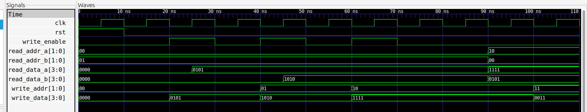
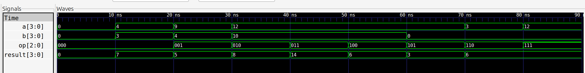
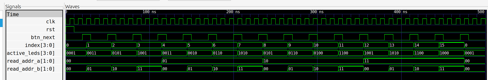
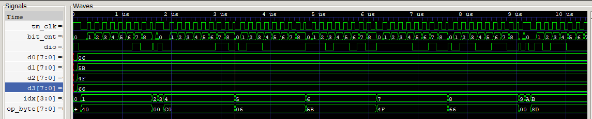
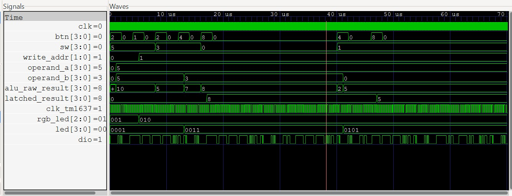

# Informe de Laboratorio: Sistema Digital Modular con ALU y Banco de Registros en FPGA Zybo Z7

**Integrantes:**
* Laura Alejandra Moreno
* Jana Rubiano Hurtado
* Johana Tellez Gamez
* Alina Idaly Ortíz Martinez

---

## Índice
1. [Descripción del Sistema](#1-descripción-del-sistema)
   - 1.1 [Banco de Registros (`reg_bank.v`)](#11-banco-de-registros-reg_bankv)
     - 1.1.1 [Especificación](#111-especificación)
     - 1.1.2 [Diseño (Explicación del Código)](#112-diseño-explicación-del-código)
     - 1.1.3 [Simulación (Análisis de Ondas en GTKWave)](#113-simulación-análisis-de-ondas-en-gtkwave)
   - 1.2 [Unidad Aritmético-Lógica (`alu.v`)](#12-unidad-aritmético-lógica-aluv)
     - 1.2.1 [Especificación](#121-especificación)
     - 1.2.2 [Diseño (Explicación del Código)](#122-diseño-explicación-del-código)
     - 1.2.3 [Simulación (Análisis de Ondas en GTKWave)](#123-simulación-análisis-de-ondas-en-gtkwave)
   - 1.3 [Selector Combinacional de Operandos (`comb_selector.v`)](#13-selector-combinacional-de-operandos-comb_selectorv)
     - 1.3.1 [Especificación](#131-especificación)
     - 1.3.2 [Diseño (Explicación del Código)](#132-diseño-explicación-del-código)
     - 1.3.3 [Simulación (Análisis de Ondas en GTKWave)](#133-simulación-análisis-de-ondas-en-gtkwave)
   - 1.4 [Driver de Visualización 7 Segmentos (`display_tm1637.v`)](#14-driver-de-visualización-7-segmentos-display_tm1637v) 
     - 1.4.1 [Especificación](#141-especificación)
     - 1.4.2 [Diseño](#142-diseño)
     - 1.4.3 [Simulación (Análisis de Ondas en GTKWave)](#143-simulación-análisis-de-ondas-en-gtkwave)
2. [Explicación de la Arquitectura Modular (`top.v`)](#2-explicación-de-la-arquitectura-modular-topv)
   - 2.1 [Especificación](#21-especificación)
   - 2.2 [Diseño](#22-diseño)
   - 2.3 [Simulación del Sistema Completo (Análisis de Ondas en GTKWave)](#23-simulación-del-sistema-completo-análisis-de-ondas-en-gtkwave)
3. [Evidencia de Funcionamiento en FPGA](#3-evidencia-de-funcionamiento-en-fpga)
   - 3.1 [Asignación de Pines y Restricciones (`Zybo-Z7.xdc`)](#31-asignación-de-pines-y-restricciones-zybo-z7xdc)
   - 3.2 [Pruebas y Evidencias de Funcionamiento Físico](#32-pruebas-y-evidencias-de-funcionamiento-físico)
4. [Análisis de Resultados](#4-análisis-de-resultados)
5. [Conclusiones](#5-conclusiones)
---

## 1. Descripción del Sistema

### 1.1 Banco de Registros (`reg_bank.v`)

#### 1.1.1 Especificación
El módulo `reg_bank.v` es la unidad de almacenamiento temporal del sistema. Su función principal es almacenar y gestionar 4 registros internos de 4 bits de ancho ($R_0, R_1, R_2, R_3$), garantizando la retención de los datos cargados y la provisión simultánea de operandos para las operaciones de la Unidad Aritmético-Lógica (ALU).

* **Capacidad de Almacenamiento:** Arreglo de memoria interna de $4 \times 4$ bits.
* **Sincronismo y Reset (`clk`, `rst`):** Operación sincrónica con el flanco de subida del reloj global (`clk`) y reinicio que inicializa los 4 registros en cero (`0000`).
* **Habilitación de Escritura (`write_enable`):** Entrada síncrona controlada por el botón de escritura (**BTN1**). Permite guardar el valor presente en los interruptores físicos **SW[3:0]** únicamente cuando la señal está activa.
* **Direccionamiento de Escritura (`write_addr`):** Código binario de 2 bits (secrenciado mediante **BTN0**) que selecciona el registro destino ($00 \rightarrow R_0$, $01 \rightarrow R_1$, $10 \rightarrow R_2$, $11 \rightarrow R_3$).
* **Puertos de Lectura Simultánea (`read_addr_A`, `read_addr_B`):** Dos entradas de selección de 2 bits provistas por el selector de combinaciones (`comb_selector.v`), permitiendo la lectura asíncrona y simultánea de dos registros.
* **Buses de Salida de Datos (`data_out_A`, `data_out_B`):** Dos buses de 4 bits que entregan de forma continua los datos de los registros seleccionados a los operandos A y B de la ALU.
* **Persistencia de Datos:** Un registro conserva su valor almacenado de forma indefinida hasta que se ejecute una nueva operación de escritura sobre su dirección específica.


#### 1.1.2 Diseño (Explicación del Código)

El módulo `reg_bank.v` implementa una memoria interna tipo *Register File* de 4 posiciones de 4 bits. Su funcionamiento general se basa en una arquitectura de almacenamiento mixto: la **escritura** es un proceso secuencial e impulsado por reloj que captura los datos de los interruptores cuando se activa el botón de habilitación, mientras que la **lectura** es completamente combinacional (asíncrona), lo que garantiza que los datos almacenados en las direcciones seleccionadas estén inmediatamente disponibles en la salida para alimentar a la ALU sin agregar ciclos de retardo.


* **Declaración de Entradas y Salidas:**
  ```verilog
  input  wire        clk,          // Reloj del sistema
  input  wire        rst,          // Reset general
  input  wire        write_enable, // Habilitador de escritura (accionado por BTN1)
  input  wire [1:0] write_addr,   // Selección del registro a escribir (BTN0)
  input  wire [3:0] write_data,   // Dato a escribir proveniente de SW[3:0]
  input  wire [1:0] read_addr_a,  // Dirección del Registro A (generado por comb_selector)
  input  wire [1:0] read_addr_b,  // Dirección del Registro B (generado por comb_selector)
  output wire [3:0] read_data_a,  // Dato de salida del Operando A hacia la ALU
  output wire [3:0] read_data_b   // Dato de salida del Operando B hacia la ALU
  ```
  Las señales de entrada permiten controlar la sincronización (`clk`, `rst`), el evento de escritura (`write_enable`, `write_addr`, `write_data`) y la consulta continua de operandos (`read_addr_a`, `read_addr_b`). Las salidas entregan directamente los valores de 4 bits de los dos registros leídos en tiempo real.

* **Estructura de Almacenamiento Interno:**
  ```verilog
  reg [3:0] registers [0:3];
  integer i;
  ```
  Se define una matriz o arreglo de registros `registers` compuesto por 4 posiciones (`[0:3]`), donde cada posición almacena un vector de 4 bits (`[3:0]`). La variable `i` de tipo `integer` se utiliza como índice para el bucle de inicialización durante el reinicio.

* **Proceso de Escritura y Reset (Lógica Secuencial / Sincrónica):**
  ```verilog
  always @(posedge clk or posedge rst) begin
      if (rst) begin
          for (i = 0; i < 4; i = i + 1) begin
              registers[i] <= 4'b0000;
          end
      end else if (write_enable) begin
          registers[write_addr] <= write_data;
      end
  end
  ```
  Este bloque `always` es sensible al flanco de subida del reloj (`posedge clk`) y al flanco de subida del reset (`posedge rst`). 
  - **Reset Asincrónico:** Si `rst` se activa (`1` lógico), se ejecuta un ciclo `for` que reinicia el contenido de los cuatro registros ($R_0$ a $R_3$) a cero binario (`4'b0000`).
  - **Escritura Sincrónica:** Si `rst` no está activo pero `write_enable` se encuentra en alto, el valor presente en `write_data` (procedente de los switches) se almacena en el registro indexado por `write_addr` mediante una asignación no bloqueante (`<=`).

* **Proceso de Lectura (Lógica Combinacional / Asincrónica):**
  ```verilog
  assign read_data_a = registers[read_addr_a];
  assign read_data_b = registers[read_addr_b];
  ```
  Mediante asignaciones continuas (`assign`), las salidas `read_data_a` y `read_data_b` reflejan de forma inmediata cualquier cambio en las direcciones de lectura `read_addr_a` y `read_addr_b`. Esto permite consultar dos posiciones de memoria de manera simultánea e independiente sin requerir flancos de reloj adicionales.


#### 1.1.3 Simulación (Análisis de Ondas en GTKWave)

En la simulación realizada se verifican las operaciones de reinicio, escritura síncrona y lectura asíncrona simultánea.

##### Análisis Cronológico de la Simulación:

1. **Intervalo 0 ns – 10 ns (Reset Asincrónico):**
    La señal `rst` permanece en alto (`1`). En el flanco de subida de `clk` en los 5 ns, los registros internos se inicializan en cero (`0000`).


2. **Intervalo 10 ns – 30 ns (Escritura en Registro $R_0$):**
   * En 10 ns se libera el reset (`rst = 0`).
   * En 20 ns se prepara la escritura: `write_addr = 00` ($R_0$), `write_data = 0101` y se activa `write_enable = 1`.
   * En el **flanco de subida de `clk` a los 25 ns**, el dato `0101` se almacena físicamente en $R_0$. 
   * Dado que `read_addr_a` está leyendo la dirección `00`, la salida `read_data_a` cambia inmediatamente en los 25 ns de `0000` a **`0101`**.

3. **Intervalo 40 ns – 50 ns (Escritura en Registro $R_1$):**
   * Se configura `write_addr = 01` ($R_1$), `write_data = 1010` ($10_{10}$ / $A_{16}$) y `write_enable = 1`.
   * En el flanco de subida de `clk` a los **45 ns**, se escribe el valor en $R_1$.
   * La salida `read_data_b` (que apunta a `read_addr_b = 01`) se actualiza instantáneamente a **`1010`**.

4. **Intervalo 60 ns – 70 ns (Escritura en Registro $R_2$):**
   * Se asigna `write_addr = 10` ($R_2$) con `write_data = 1111` ($15_{10}$ / $F_{16}$) y `write_enable = 1`.
   * En los **65 ns** (`posedge clk`), el dato `1111` se guarda correctamente en $R_2$.

5. **Intervalo 80 ns – 90 ns (Verificación de Lectura Asíncrona Simultánea):**
   * En el instante de los **80 ns**, se cambian las direcciones de lectura: `read_addr_a` pasa a `10` ($R_2$) y `read_addr_b` pasa a `00` ($R_0$).
   * De forma **inmediata y sin esperar un flanco de reloj**, las salidas se actualizan: `read_data_a` entrega **`1111`** ($R_2$) y `read_data_b` entrega **`0101`** ($R_0$). Esto confirma que la lectura es puramente combinacional.

6. **Intervalo 95 ns – 110 ns (Prueba de Inhabilitación de Escritura):**
   * Se coloca `write_addr = 11` ($R_3$) y `write_data = 0011`, pero se mantiene **`write_enable = 0`**.
   * En el flanco de reloj de los 105 ns, los registros mantienen intactos sus valores guardados, demostrando la persistencia del almacenamiento ante escrituras deshabilitadas.




---


### 1.2 Unidad Aritmético-Lógica (`alu.v`)

#### 1.2.1 Especificación

El módulo `alu.v` constituye el núcleo de procesamiento matemático y lógico del sistema. Su función principal es recibir dos operandos binarios de 4 bits ($A$ y $B$), provenientes de los puertos de lectura simultánea del banco de registros, y aplicar sobre ellos la operación seleccionada por el usuario mediante un código de control de 3 bits. 

La ALU es un módulo **puramente combinacional**, lo que significa que no almacena estado interno ni depende de una señal de reloj (`clk`); la salida se actualiza de manera instantánea ante cualquier variación en sus entradas de operandos o de selección de operación.

* **Operando A (`a[3:0]`):** Bus de entrada de 4 bits que recibe el primer dato desde la salida `read_data_a` del banco de registros.
* **Operando B (`b[3:0]`):** Bus de entrada de 4 bits que recibe el segundo dato desde la salida `read_data_b` del banco de registros.
* **Código de Operación (`op[2:0]`):** Bus de selección de 3 bits conectado físicamente a los conmutadores **SW[2:0]**, el cual permite elegir entre 8 operaciones distintas.
* **Bus de Resultado (`result[3:0]`):** Bus de salida combinacional de 4 bits que entrega de forma directa la solución de la operación ejecutada hacia el módulo de captura para la visualización.


La ALU ejecuta operaciones aritméticas básicas, lógicas a nivel de bits y de desplazamiento (shifts) de acuerdo con la siguiente codificación binaria:

| Código de operación (`op[2:0]`) | Operación | Expresión Matemática / Lógica | Descripción |
| :---: | :--- | :---: | :--- |
| `3'b000` | Suma aritmética | $A + B$ | Suma binaria de 4 bits entre operando A y B. |
| `3'b001` | Resta aritmética | $A - B$ | Resta binaria entre A y B (resultado en complemento a dos en 4 bits). |
| `3'b010` | AND bit a bit | $A \land B$ | Operación lógica conjunción bit por bit. |
| `3'b011` | OR bit a bit | $A \lor B$ | Operación lógica disyunción bit por bit. |
| `3'b100` | XOR bit a bit | $A \oplus B$ | Operación lógica OR exclusiva bit por bit. |
| `3'b101` | NOT bit a bit | $\sim A$ | Inversión bit a bit del operando A. |
| `3'b110` | Desplazamiento a la izquierda | $A \ll 1$ | Desplazamiento lógico de A un bit a la izquierda (introduce '0' en LSB). |
| `3'b111` | Desplazamiento a la derecha | $A \gg 1$ | Desplazamiento lógico de A un bit a la derecha (introduce '0' en MSB). |


#### 1.2.2 Diseño (Explicación del Código)

El módulo `alu.v` se diseñó como un circuito puramente combinacional empleando una estructura de selección múltiple `case`. La ausencia de señales de reloj (`clk`) o elementos de memoria garantiza que la ALU responda en tiempo real a las variaciones en los operandos de entrada o en la selección de la operación.

##### Desglose del Código por Secciones:

* **Declaración del Módulo y Puertos:**
  ```verilog
  input  wire [3:0] a,        // Operando A (4 bits)
  input  wire [3:0] b,        // Operando B (4 bits)
  input  wire [2:0] op,       // Selección de operación SW[2:0]
  output reg  [3:0] result    // Resultado de la ALU (4 bits)
  ```
  - `a` y `b` son buses de entrada de 4 bits asignados como tipo `wire` que reciben los datos guardados en el banco de registros.
  - `op` es el bus de 3 bits que especifica la instrucción a realizar.
  - `result` se declara como tipo `reg` únicamente porque su valor es asignado dentro de un bloque procedimental `always`, aunque físicamente sintetiza lógica combinacional (multiplexor de operaciones).

* **Bloque Combinacional Procedimental:**
  ```verilog
  always @(*) begin
  ```
  La lista de sensibilidad implícita `(*)` indica que el bloque `always` se ejecutará de forma automática e instantánea ante cualquier cambio en cualquiera de sus entradas (`a`, `b` o `op`).

* **Estructura de Decisión y Operaciones:**
  ```verilog
  case (op)
      3'b000: result = a + b;       // Suma
      3'b001: result = a - b;       // Resta
      3'b010: result = a & b;       // AND bit a bit
      3'b011: result = a | b;       // OR bit a bit
      3'b100: result = a ^ b;       // XOR bit a bit
      3'b101: result = ~a;          // NOT A bit a bit
      3'b110: result = a << 1;      // Desplazamiento a la izquierda de A
      3'b111: result = a >> 1;      // Desplazamiento a la derecha de A
      default: result = 4'b0000;
  endcase
  ```
  - La sentencia `case` evalúa el valor binario de `op` (de `3'b000` a `3'b111`) para enrutar el resultado de la operación correspondiente hacia `result`.

#### 1.2.3 Simulación (Análisis de Ondas en GTKWave)

La simulación del módulo `alu.v` valida el comportamiento combinacional y la precisión de cada una de las 8 operaciones configurables del sistema. En la gráfica de ondas se observa que las salidas responden de forma instantánea al cambiar los operandos `a[3:0]`, `b[3:0]` o la operación `op[2:0]`[cite: 3].

##### Análisis Cronológico de la Simulación:

1. **Intervalo 0 ns – 10 ns (Suma Cero):**
   * **Configuración:** `op = 000` (Suma), `a = 0`, `b = 0`
   * **Resultado:** `result = 0` ($0 + 0 = 0$)

2. **Intervalo 10 ns – 20 ns (Suma Aritmética):**
   * **Configuración:** `op = 000` (Suma), `a = 4`, `b = 3`
   * **Resultado:** `result = 7` ($4 + 3 = 7$)

3. **Intervalo 20 ns – 30 ns (Resta Aritmética):**
   * **Configuración:** `op = 001` (Resta), `a = 9`, `b = 4`
   * **Resultado:** `result = 5` ($9 - 4 = 5$)

4. **Intervalo 30 ns – 40 ns (Operación Lógica AND):**
   * **Configuración:** `op = 010` (AND), `a = 12` ($1100_2$), `b = 10` ($1010_2$)
   * **Resultado:** `result = 8` ($1000_2$). Se cumple la conjunción bit por bit ($1100_2 \land 1010_2 = 1000_2$)

5. **Intervalo 40 ns – 50 ns (Operación Lógica OR):**
   * **Configuración:** `op = 011` (OR), `a = 12` ($1100_2$), `b = 10` ($1010_2$)
   * **Resultado:** `result = 14` ($1110_2$). Se cumple la disyunción bit por bit ($1100_2 \lor 1010_2 = 1110_2$)

6. **Intervalo 50 ns – 60 ns (Operación Lógica XOR):**
   * **Configuración:** `op = 100` (XOR), `a = 12` ($1100_2$), `b = 10` ($1010_2$)
   * **Resultado:** `result = 6` ($0110_2$). Se cumple la disyunción exclusiva ($1100_2 \oplus 1010_2 = 0110_2$)

7. **Intervalo 60 ns – 70 ns (Inversión Lógica NOT A):**
   * **Configuración:** `op = 101` (NOT A), `a = 12` ($1100_2$), `b = 0`
   * **Resultado:** `result = 3` ($0011_2$). Invierte individualmente cada bit de $A$ ($\sim 1100_2 = 0011_2$)

8. **Intervalo 70 ns – 80 ns (Desplazamiento Lógico a la Izquierda):**
   * **Configuración:** `op = 110` (Shift Left $A \ll 1$), `a = 3` ($0011_2$), `b = 0`
   * **Resultado:** `result = 6` ($0110_2$). Se desplazan los bits de $A$ hacia la izquierda introduciendo un `0` en el LSB ($0011_2 \ll 1 = 0110_2$)

9. **Intervalo 80 ns en adelante (Desplazamiento Lógico a la Derecha):**
   * **Configuración:** `op = 111` (Shift Right $A \gg 1$), `a = 12` ($1100_2$), `b = 0`
   * **Resultado:** `result = 6` ($0110_2$). Se desplazan los bits de $A$ hacia la derecha introduciendo un `0` en el MSB ($1100_2 \gg 1 = 0110_2$)



---

### 1.3 Selector Combinacional de Operandos (`comb_selector.v`)

#### 1.3.1 Especificación

El módulo `comb_selector.v` es el encargado de administrar la selección dinámica de los registros que actuarán como operando A y operando B para la ALU. A través del pulso generado al presionar el botón **BTN2**, el módulo recorre de manera secuencial todas las combinaciones posibles de lectura entre los 4 registros ($4 \times 4 = 16$ pares de operandos) y retroalimenta visualmente al usuario encendiendo los LEDs correspondientes en la tarjeta Zybo Z7.

##### Entradas, Salidas y Requerimientos Funcionales:
* **Reloj y Reset (`clk`, `rst`):** Control sincrónico para la transición de estados e inicialización del contador interno a cero.
* **Pulso de Avanzar (`btn_next`):** Entrada de un solo ciclo de reloj (proveniente del filtrado del botón **BTN2**) que incrementa el índice de combinaciones.
* **Direcciones de Lectura (`read_addr_a[1:0]`, `read_addr_b[1:0]`):** Salidas de 2 bits enviadas al banco de registros para seleccionar las direcciones de lectura de los operandos A y B.
* **Máscara de LEDs Activos (`active_leds[3:0]`):** Salida de 4 bits conectada directamente a los **LED[3:0]** de la tarjeta. Activa en `'1'` lógico únicamente los LEDs asociados a los registros involucrados en la combinación actual.

##### Secuencia de Combinaciones y Mapeo de LEDs:

| Pulsación (**BTN2**) | Contador `index[3:0]` | Operando A `read_addr_a[1:0]` | Operando B `read_addr_b[1:0]` | Registros Seleccionados | Máscara LEDs (`active_leds[3:0]`) | LEDs Encendidos |
| :---: | :---: | :---: | :---: | :---: | :---: | :---: |
| Inicio (Reset) | `0000` (0) | `00` (0) | `00` (0) | $A = R_0$, $B = R_0$ | `4'b0001` | **LED0** |
| 1.ª pulsación | `0001` (1) | `00` (0) | `01` (1) | $A = R_0$, $B = R_1$ | `4'b0011` | **LED0 y LED1** |
| 2.ª pulsación | `0010` (2) | `00` (0) | `10` (2) | $A = R_0$, $B = R_2$ | `4'b0101` | **LED0 y LED2** |
| 3.ª pulsación | `0011` (3) | `00` (0) | `11` (3) | $A = R_0$, $B = R_3$ | `4'b1001` | **LED0 y LED3** |
| 4.ª pulsación | `0100` (4) | `01` (1) | `00` (0) | $A = R_1$, $B = R_0$ | `4'b0011` | **LED1 y LED0** |
| ... | ... | ... | ... | ... | ... | ... |
| 15.ª pulsación | `1111` (15) | `11` (3) | `11` (3) | $A = R_3$, $B = R_3$ | `4'b1000` | **LED3** |
| 16.ª pulsación | `0000` (0) | `00` (0) | `00` (0) | Reinicio: $A = R_0$, $B = R_0$ | `4'b0001` | **LED0** |

---

#### 1.3.2 Diseño (Explicación del Código)

El diseño combina una máquina de estados implícita basada en un contador de 4 bits con lógica combinacional de decodificación para la selección de operandos y manejo de indicadores luminosos.

##### Desglose del Código por Secciones:

* **Declaración de Puertos:**
  ```verilog
  input  wire        clk,          // Reloj principal
  input  wire        rst,          // Reset general
  input  wire        btn_next,     // Pulso al presionar BTN2
  output wire [1:0] read_addr_a,  // Dirección seleccionada para Operando A (0 a 3)
  output wire [1:0] read_addr_b,  // Dirección seleccionada para Operando B (0 a 3)
  output wire [3:0] active_leds   // Salida directa hacia LED[3:0]
  ```
  Permite la sincronización mediante el reloj global, la recepción de eventos del usuario y la emisión directa de direcciones de lectura e indicadores luminosos.

* **Registro de Estado Interno:**
  ```verilog
  reg [3:0] index;
  ```
  Se declara una variable tipo `reg` de 4 bits `index` que actúa como contador de $0$ a $15$. Al alcanzar el valor `1111` ($15$), el siguiente incremento causa un desbordamiento natural (*overflow*) retornando automáticamente a `0000` ($0$).

* **Proceso Secuencial de Transición de Estados:**
  ```verilog
  always @(posedge clk or posedge rst) begin
      if (rst) begin
          index <= 4'b0000;
      end else if (btn_next) begin
          index <= index + 1'b1;
      end
  end
  ```
  - Sensible al flanco de subida de `clk` o `rst`.
  - Si `rst = 1`, la variable `index` se fuerza a `0000`.
  - Cuando se recibe un pulso activo en `btn_next`, se incrementa el contador en 1 unidad mediante una asignación no bloqueante (`<=`).

* **Decodificación de Direcciones de Lectura:**
  ```verilog
  assign read_addr_a = index[3:2];
  assign read_addr_b = index[1:0];
  ```
  Se dividen los 4 bits del contador en dos segmentos de 2 bits:
  - Los 2 bits más significativos (`index[3:2]`) determinan la dirección del **Operando A**. Cambian cada 4 pulsaciones.
  - Los 2 bits menos significativos (`index[1:0]`) determinan la dirección del **Operando B**. Cambian con cada pulsación.

* **Generación de Indicadores LED (*One-Hot Decoding*):**
  ```verilog
  assign active_leds = (4'b0001 << read_addr_a) | (4'b0001 << read_addr_b);
  ```
  Para representar visualmente los registros activos:
  - Se decodifica la dirección de `read_addr_a` desplazando el bit de menor peso (`4'b0001 << read_addr_a`). Por ejemplo, si `read_addr_a = 2'b10` ($2$), resulta en `4'b0100`.
  - Se realiza la misma operación con `read_addr_b`.
  - Se aplica una operación **OR bit a bit** (`|`) entre ambas máscaras. De esta manera, si ambos operandos leen del mismo registro (ej. $R_0$ y $R_0$), solo se enciende un LED (`LED0`); si leen de registros distintos (ej. $R_0$ y $R_1$), se encienden ambos LEDs (`LED0` y `LED1`).
  

#### 1.3.3 Simulación (Análisis de Ondas en GTKWave)

La simulación del módulo `comb_selector.v` confirma el avance secuencial de las 16 combinaciones de lectura entre los registros ($R_0$ a $R_3$) y la actualización inmediata de la máscara de LEDs (`active_leds[3:0]`).

##### Análisis Cronológico de la Simulación:

1. **Estado Inicial y Reset (0 ns – 20 ns):** La señal `rst` inicializa el contador en `index = 0` (`4'b0000`). Se seleccionan los operandos $A = R_0$ y $B = R_0$ (`read_addr_a = 00`, `read_addr_b = 00`), activando únicamente el **LED0** (`active_leds = 0001`).

2. **Ciclo con Operando A en $R_0$ (`index = 0` a `3`):** Con cada pulso en `btn_next`, el operando B recorre secuencialmente los registros de $R_0$ a $R_3$ (`read_addr_b` de `00` a `11`). La salida `active_leds` enciende los pares de LEDs correspondientes (**LED0** combinado con **LED0**, **LED1**, **LED2** y **LED3**).

3. **Ciclo con Operando A en $R_1$, $R_2$ y $R_3$ (`index = 4` a `15`):** Cada 4 pulsaciones, los bits más significativos (`index[3:2]`) incrementan la dirección del operando A (`read_addr_a`). Cuando $A$ y $B$ apuntan al mismo registro (ej. `index = 5` donde $A=R_1, B=R_1$), la máscara activa solo ese LED individual (`0010`).

4. **Desbordamiento (*Overflow*) y Reinicio (`index = 15` $\rightarrow$ `0`):** En `index = 15` (`4'b1111`), con $A = R_3$ y $B = R_3$ (**LED3** activo), el siguiente pulso desborda el contador de 4 bits a `0` (`4'b0000`), reiniciando el ciclo correctamente.



---


### 1.4 Driver de Visualización 7 Segmentos (`display_tm1637.v`)

#### 1.4.1 Especificación

El módulo `display_tm1637.v` (junto con sus submódulos auxiliares `hex7seg.v` y `tm1637_driver.v`) es el encargado de convertir el resultado binario de 4 bits procesado por la ALU en patrones de iluminación compatibles con la pantalla de 4 dígitos de 7 segmentos con controlador TM1637.

Su función principal es ofrecer una **estrategia de visualización dual seleccionable** (Binaria y Decimal), permitiendo interpretar claramente los datos procesados, y gestionar la transmisión serie mediante el protocolo propietario del chip TM1637 a partir del reloj del sistema de la Zybo Z7 (125 MHz).

##### Entradas, Salidas y Requerimientos Funcionales:
* **Reloj del Sistema (`clk`):** Reloj principal a 125 MHz (`CLK_HZ = 125_000_000`).
* **Reset (`rst`):** Entrada de reinicio síncrono del controlador de transmisión.
* **Dato de Entrada (`data_in[3:0]`):** Bus de 4 bits que recibe el resultado congelado/almacenado de la ALU tras presionar **BTN3**.
* **Selección de Modo (`mode_sel`):** Entrada de control que conmuta la estrategia de representación entre binaria y decimal.
* **Reloj Serie TM1637 (`clk_tm1637`):** Salida de reloj serie generada para sincronizar la comunicación con el módulo TM1637.
* **Línea de Datos Bi-direccional (`dio`):** Línea de datos serie configurada en modo colector/drenador abierto (*open-drain*), requerida por el bus del chip TM1637.


El sistema permite seleccionar mediante la señal `mode_sel` dos formas complementarias de representación del resultado:

1. **Modo Binario (`mode_sel = 1`):**
   * Muestra de forma explícita el valor de cada uno de los 4 bits del resultado (`data_in[3:0]`) a lo largo de los 4 dígitos de la pantalla ($d_0, d_1, d_2, d_3$).
   * Cada dígito enciende un carácter `'1'` (segmentos $b, c$) si el bit es `1`, o un carácter `'0'` (segmentos $a, b, c, d, e, f$) si el bit es `0`.
   * El dígito $d_0$ (extremo izquierdo) representa el bit más significativo (MSB, `data_in[3]`) y el dígito $d_3$ (extremo derecho) representa el bit menos significativo (LSB, `data_in[0]`).

2. **Modo Decimal (`mode_sel = 0`):**
   * Decodifica el resultado de 4 bits (rango $0$ a $15$) en formato decimal de dos dígitos (Decenas y Unidades).
   * Los dos primeros dígitos ($d_0$ y $d_1$) permanecen apagados.
   * El tercer dígito ($d_2$) muestra un `'1'` únicamente si el valor es mayor o igual a 10 (`hay_decena`), permaneciendo apagado si es menor a 10.
   * El cuarto dígito ($d_3$) representa las unidades ($0$ a $9$) decodificadas a 7 segmentos mediante el módulo `hex7seg.v`.

##### Tabla Resumen de Representación en Pantalla:

| Modo (`mode_sel`) | Resultado `data_in` | Dígito 0 ($d_0$) | Dígito 1 ($d_1$) | Dígito 2 ($d_2$) | Dígito 3 ($d_3$) | Interpretación Visual |
| :---: | :---: | :---: | :---: | :---: | :---: | :--- |
| `1` (Binario) | `4'b1010` ($10_{10}$) | `1` | `0` | `1` | `0` | Muestra `1 0 1 0` |
| `1` (Binario) | `4'b0101` ($5_{10}$) | `0` | `1` | `0` | `1` | Muestra `0 1 0 1` |
| `0` (Decimal) | `4'b0101` ($5_{10}$) | *Apagado* | *Apagado* | *Apagado* | `5` | Muestra `5` |
| `0` (Decimal) | `4'b1100` ($12_{10}$) | *Apagado* | *Apagado* | `1` | `2` | Muestra `1 2` |

#### 1.4.2 Diseño 

El sistema de visualización se compone de tres módulos jerárquicos: `display_tm1637.v` (módulo superior de visualización), `hex7seg.v` (decodificador combinacional de 7 segmentos) y `tm1637_driver.v` (controlador de bajo nivel del protocolo serie).

---

##### 1. Módulo Superior de Visualización (`display_tm1637.v`)

Este módulo procesa el dato binario de 4 bits `data_in`, aplica la lógica de conversión (binaria o decimal) y entrega los patrones de segmentos formateados en 8 bits al driver serie.

* **Cálculo de Decenas y Unidades (Lógica Combinacional):**
  ```verilog
  wire        hay_decena = (data_in >= 4'd10);
  wire [3:0] unidades   = hay_decena ? (data_in - 4'd10) : data_in;
  wire [6:0] s_uni;

  hex7seg h_uni (.hex(unidades), .seg(s_uni));
  ```
  Se determina si el valor recibido es mayor o igual a 10. Si se cumple, se resta 10 para obtener las unidades ($0$ a $5$) y se envían al decodificador `hex7seg`.

* **Conmutación de Modo de Visualización (`mode_sel`):**
  ```verilog
  always @(*) begin
      if (mode_sel) begin
          d0 = data_in[3] ? UNO : CERO;
          d1 = data_in[2] ? UNO : CERO;
          d2 = data_in[1] ? UNO : CERO;
          d3 = data_in[0] ? UNO : CERO;
      end else begin
          d0 = APAG;
          d1 = APAG;
          d2 = hay_decena ? UNO : APAG;
          d3 = {1'b0, s_uni};
      end
  end
  ```
  - **Modo Binario (`mode_sel = 1`):** Asigna a cada uno de los 4 dígitos (`d0` a `d3`) la constante `UNO` (`8'h06`) o `CERO` (`8'h3F`) según el bit correspondiente de `data_in[3:0]`.
  - **Modo Decimal (`mode_sel = 0`):** Apaga los dos primeros dígitos (`d0` y `d1`). Si `hay_decena = 1`, asigna `UNO` a `d2` (decenas); de lo contrario, lo apaga. El dígito `d3` recibe la codificación de 7 segmentos de las unidades.

---

##### 2. Decodificador de 7 Segmentos (`hex7seg.v`)

Convierte una entrada hexadecimal de 4 bits en la combinación de 7 segmentos correspondiente ($a, b, c, d, e, f, g$).

```verilog
always @(*) begin
    case (hex)
        4'h0: seg = 7'h3F; // Cero
        4'h1: seg = 7'h06; // Uno
        ...
        4'h9: seg = 7'h6F; // Nueve
        default: seg = 7'h71;
    endcase
end
```
Mapea cada dígito decimal/hexadecimal a su máscara de segmentos activa en alto.

---

##### 3. Controlador de Protocolo TM1637 (`tm1637_driver.v`)

Implementa la máquina de estados finitos (FSM) encargada de serializar los datos y transmitirlos respetando la temporización del controlador TM1637.

* **Divisor de Frecuencia (Generación de Tick):**
  ```verilog
  localparam integer DIV = CLK_HZ / TICK_HZ; // 125 MHz / 200 kHz = 625 ciclos
  ```
  Genera un pulso periódico de un ciclo (`tick`) a 200 kHz (período de 5 µs), marcando el ritmo de avance de la FSM de transmisión.

* **Manejo de Línea Bi-direccional en Drenador Abierto (*Open-Drain*):**
  ```verilog
  assign tm_dio = dio_low ? 1'b0 : 1'bz;
  ```
  El protocolo TM1637 requiere una línea `DIO` en colector/drenador abierto. Cuando `dio_low = 1`, la FPGA fuerza un `'0'` lógico a tierra; cuando `dio_low = 0`, la salida entra en alta impedancia (`1'bz`), permitiendo que una resistencia de *pull-up* externa mantenga la línea en `'1'` o que el chip TM1637 envíe el bit de reconocimiento (ACK).

* **Máquina de Estados y Secuencia de Comandos:**
  La FSM ejecuta una secuencia continua de 13 operaciones (`idx` de 0 a 12) para actualizar la pantalla:
  1. **`idx = 0..2` (Secuencia de Inicio y Comando de Datos):** Envía la señal *START* y el byte `0x40` (modo de dirección auto-incrementada).
  2. **`idx = 3..9` (Envío de Dirección y Datos de Dígitos):** Envía el byte `0xC0` (dirección base del primer dígito) seguido de los bytes de segmentos `d0`, `d1`, `d2` y `d3` de forma secuencial LSB primero (*Least Significant Bit First*).
  3. **`idx = 10..12` (Comando de Control de Pantalla):** Envía el byte `0x88 | brillo` para fijar la intensidad luminosa (configurada en 5/7) y dirigir la secuencia hacia la parada (*STOP*).


#### 1.4.3 Simulación (Análisis de Ondas en GTKWave)

La simulación del banco de pruebas `tb_tm1637_driver.v` permite evaluar el comportamiento de la máquina de estados finitos (FSM) del controlador de bajo nivel `tm1637_driver.v`. En este entorno de prueba unitaria, se inyectan directamente los patrones de 7 segmentos precalculados en las entradas del módulo: `d0 = 0x06` (dígito 1), `d1 = 0x5B` (dígito 2), `d2 = 0x4F` (dígito 3) y `d3 = 0x66` (dígito 4).

##### 1. Desglose del Flujo por Estados (`idx`) y Carga de Bytes (`op_byte`)

En la simulación se aprecia el avance secuencial del registro de estado `idx` (del `0` al `B` en hexadecimal) y cómo se carga dinámicamente cada dato en el bus interno `op_byte[7:0]` para ser transmitido hacia el bus serie:

* **Trama 1 (Configuración de Modo):**
  * `idx = 0`: Emisión de la condición de *START* (bajada de la línea `dio` con reloj en alto).
  * `idx = 1`: El bus `op_byte` carga el comando **`0x40`** (`40` en hex), configurando la memoria interna del TM1637 en modo de direccionamiento automático.
  * `idx = 2`: Condición de *STOP* (`op_byte = 0x00`), cerrando la primera trama.

* **Trama 2 (Ráfaga de Dirección y Datos de Dígitos):**
  * `idx = 3`: Emisión de la condición de *START*.
  * `idx = 4`: El bus `op_byte` toma el valor **`0xC0`** (dirección base del primer dígito).
  * `idx = 5`: Carga secuencial de `d0` (`op_byte = 0x06`).
  * `idx = 6`: Carga secuencial de `d1` (`op_byte = 0x5B`).
  * `idx = 7`: Carga secuencial de `d2` (`op_byte = 0x4F`).
  * `idx = 8`: Carga secuencial de `d3` (`op_byte = 0x66`).
  * `idx = 9`: Condición de *STOP*, finalizando la ráfaga continua de los 4 dígitos.

* **Trama 3 (Encendido y Control de Brillo):**
  * `idx = A` ($10_{10}$): Emisión de la condición de *START*.
  * `idx = B` ($11_{10}$): Carga en `op_byte` del comando **`0x8D`** (`0x88` del comando de encendido procesado mediante una operación OR binaria con el nivel de brillo `3'd5`).

##### 2. Sincronización y Serialización (`bit_cnt` y `dio`)

Cada vez que el estado `idx` selecciona un estado de envío de byte (`OP_BYTE`), la señal de reloj serie `tm_clk` entra en operación y el contador de bits `bit_cnt` incrementa ordenadamente de `0` a `8`:
* Durante los conteos del `0` al `7`, el módulo extrae uno a uno los bits del registro `op_byte` (comenzando por el LSB) y los conmuta sobre la línea bi-direccional `dio`.
* En el conteo `8` (noveno pulso), la FPGA conmuta la línea `dio` a alta impedancia para recibir la respuesta de confirmación (ACK) del receptor, validando que el flujo serie se mantiene sincronizado y libre de errores.


## 2. Explicación de la Arquitectura Modular (`top.v`)
### 2.1 Especificación

El módulo principal `top.v` tiene como función principal  integrar, interconectar y coordinar el flujo de datos entre los submódulos previamente diseñados (`btn_debounce`, `reg_bank`, `comb_selector`, `alu` y `display_tm1637`), mapeando sus señales hacia los periféricos físicos de la tarjeta FPGA Zybo Z7.

#### Entradas, Salidas y Mapeo de Periféricos:

* **Reloj del Sistema (`clk`):** Entrada principal conectada al oscilador de 125 MHz de la tarjeta Zybo Z7.
* **Switches de Entrada (`sw[3:0]`):** Bus de 4 interruptores con doble función:
  1. Durante la carga de datos (al presionar **BTN1**), proveen el valor binario de 4 bits a escribir en el banco de registros.
  2. Durante la evaluación de la ALU, los 3 bits inferiores `sw[2:0]` seleccionan el código de operación.
* **Botones de Control (`btn[3:0]`):** Entradas conectadas a pulsadores físicos con las siguientes funciones:
  * **BTN0:** Incrementa secuencialmente la dirección de escritura del banco de registros (`write_addr`).
  * **BTN1:** Genera el pulso de habilitación de escritura (`we`) para almacenar `sw[3:0]` en el registro seleccionado.
  * **BTN2:** Avanza a la siguiente combinación de operandos de lectura ($A$ y $B$) en el selector combinacional.
  * **BTN3:** Ejecuta la operación actual y congela (*latch*) el resultado de la ALU para su visualización.
* **Salidas LED (`led[3:0]`):** Indican visualmente los registros activos seleccionados para la operación actual mediante la máscara `active_leds`.
* **LED RGB (`rgb_led[2:0]`):** Proporcionan retroalimentación visual sobre el estado del sistema y la selección del modo de operación.
* **Interfaz del Display (`clk_tm1637`, `dio`):** Señal de reloj serie y línea de datos bidireccional conectadas a la pantalla de 7 segmentos de 4 dígitos TM1637.

---

### 2.2 Diseño

La arquitectura del módulo `top.v` sigue una estructura jerárquica basada en la interconexión de bloques funcionales y la sincronización de eventos mediante pulsos antirrebote.
##### 1. Filtrado de Entradas (Antirrebote):
Las 4 entradas de botones `btn[3:0]` se procesan individualmente mediante 4 instancias del módulo `btn_debounce` (`deb0`, `deb1`, `deb2`, `deb3`). Esto garantiza que los rebotes mecánicos sean eliminados y se generen pulsos limpios de exactamente un ciclo de reloj (`btn_clean[3:0]`).

##### 2. Gestión de Carga en el Banco de Registros:
Un registro interno de 2 bits `write_addr` mantiene la dirección del registro destino ($R_0$ a $R_3$).
* Al presionar **BTN0** (`btn_clean[0]`), `write_addr` incrementa en 1 unidad.
* Al presionar **BTN1** (`btn_clean[1]`), se activa la señal de habilitación `we = 1`, almacenando el dato presente en `sw[3:0]` dentro de `reg_bank[write_addr]`.

##### 3. Selección Dinámica de Operandos e Indicadores LED:
El botón **BTN2** (`btn_clean[2]`) alimenta la entrada `btn_next` del módulo `comb_selector`. 
* Este módulo entrega las direcciones `read_addr_a` y `read_addr_b` al banco de registros.
* El banco de registros devuelve en tiempo real los operandos `read_data_a` y `read_data_b`.
* El selector genera la máscara `active_leds[3:0]` que se asigna directamente a la salida `led[3:0]`, encendiendo los indicadores asociados a los registros bajo lectura.

##### 4. Procesamiento en la ALU y Latch de Resultado (`latched_result`):
La `alu` recibe los operandos `read_data_a`, `read_data_b` y el código de operación proveniente de `sw[2:0]`, produciendo la salida combinacional `alu_out`.

Para evitar cambios no deseados en la pantalla durante la conmutación de los interruptores o la selección de operandos, se implementa un registro de retención (`latched_result`):
```verilog
always @(posedge clk or posedge rst) begin
    if (rst) begin
        latched_result <= 4'b0000;
    end else if (btn_clean[3]) begin
        latched_result <= alu_out;
    end
end
```
* Únicamente al presionar **BTN3** (`btn_clean[3]`), el resultado instantáneo de la ALU se almacena en `latched_result`.
* Este valor se mantiene **persistente** en la memoria del registro hasta la siguiente pulsación de **BTN3**, garantizando estabilidad en la lectura.

##### 5. Visualización en Pantalla:
El registro `latched_result` se conecta como entrada `data_in` del módulo `display_tm1637`. Este módulo convierte la palabra binaria y administra el driver serie `tm1637_driver` para transmitir los paquetes de datos a través de `clk_tm1637` y la línea bidireccional `dio`.


### 2.3 Simulación del Sistema Completo (Análisis de Ondas en GTKWave)

La simulación del módulo superior `top.v` a través del banco de pruebas `tb_top.v` permite verificar la integración y el flujo de datos completo entre el banco de registros, la ALU, el selector combinacional, la lógica antirrebote y el driver del display TM1637.

#### Análisis Paso a Paso de las Formas de Onda:

##### 1. Escritura de Datos en el Banco de Registros (0 µs a 15 µs):
* **Carga en Registro 0 ($R_0$):** Inicialmente `write_addr` se encuentra en `0`. Se establece `sw[3:0] = 5` y se genera un pulso en `btn[1]` (`btn = 2` en hexadecimal). El valor $5$ queda almacenado en $R_0$, reflejándose de inmediato en la entrada `operand_a = 5`.
* **Incremento de Dirección:** A los ~10 µs se presiona el botón **BTN0** (`btn = 1`), lo que incrementa la dirección de escritura a `write_addr = 1` ($R_1$).
* **Carga en Registro 1 ($R_1$):** Se ajusta `sw[3:0] = 3` y se aplica un nuevo pulso de escritura con **BTN1** (`btn = 2`) a los ~12 µs. El valor $3$ queda almacenado en $R_1$.

##### 2. Selección de Operandos e Indicadores LED (15 µs a 20 µs):
* A los ~17 µs se pulsa **BTN2** (`btn = 4`), avanzando la combinación del selector combinacional para leer los registros $A = R_0$ ($5$) y $B = R_1$ ($3$).
* La señal `operand_b` conmuta de $5$ a $3$. Simultáneamente, la salida `led[3:0]` pasa de `0001` a `0011`, encendiendo los LEDs indicadores asociados a los registros $R_0$ y $R_1$ que están bajo evaluación.

##### 3. Evaluación de la ALU y Latch de Resultado (20 µs a 70 µs):
* **Ejecución de la Suma (20 µs - 25 µs):** Con `sw[2:0] = 0` (código de operación Suma), la ALU calcula en tiempo real su salida combinacional `alu_raw_result = 8` ($5 + 3$).
* **Captura con BTN3 (22 µs):** Al presionar **BTN3** (`btn = 8`), el registro de retención almacena la salida de la ALU, haciendo que `latched_result` pase de `0` a **`8`**.
* **Demostración de Persistencia (25 µs - 45 µs):** A los ~41 µs se conmuta la entrada `sw` a `1` (código de Resta) y se pulsa **BTN2** (`btn = 4`), cambiando `operand_b` a `0`. La salida cruda `alu_raw_result` cae inmediatamente a `5` ($5 - 0$). Sin embargo, la señal `latched_result` **permanece congelada en 8**, demostrando que la pantalla no experimenta fluctuaciones mientras el usuario manipula los interruptores.
* **Actualización del Latch (48 µs):** Al presionar nuevamente **BTN3** (`btn = 8`), el nuevo resultado `5` se transfiere finalmente a `latched_result`.

##### 4. Actividad en la Interfaz TM1637:
Durante todo el ciclo de simulación, la señal de reloj `clk_tm1637` genera un pulso continuo de comunicación y el canal bidireccional `dio` transmite datos en serie. Cada actualización en `latched_result` activa automáticamente el envío del paquete de datos hacia el controlador del display de 7 segmentos.



---

## 3. Evidencia de Funcionamiento en FPGA

### 3.1 Asignación de Pines y Restricciones (`Zybo-Z7.xdc`)

El archivo de restricciones de Xilinx (`.xdc`) establece la asignación física entre los puertos lógicos declarados en el módulo superior (`top.v`) y las patillas o pines físicos del chip FPGA Zynq-7000 presente en la tarjeta de desarrollo Zybo Z7.

Todas las señales digitales del proyecto utilizan el estándar de E/S **`LVCMOS33`** (Lógica CMOS a 3.3 V), el cual asegura la compatibilidad eléctrica tanto con los periféricos integrados en la placa (conmutadores, botones y LEDs) como con los pines de los conectores de extensión externa empleados para la interfaz con el display TM1637.

Tabla de Mapeo de Puertos y Periféricos:

| Puerto Lógico (`top.v`) | Pin Físico (FPGA) | Estándar I/O | Periférico / Ubicación Zybo Z7 | Función en el Sistema |
| :---: | :---: | :---: | :--- | :--- |
| `clk` | `K17` | `LVCMOS33` | Oscilador de Sistema (125 MHz) | Reloj principal para la lógica síncrona. |
| `sw[0]` | `G15` | `LVCMOS33` | Interruptor `SW0` | LSB de carga de datos o bit 0 de selección ALU (`op[0]`). |
| `sw[1]` | `P15` | `LVCMOS33` | Interruptor `SW1` | Bit 1 de carga de datos o bit 1 de selección ALU (`op[1]`). |
| `sw[2]` | `W13` | `LVCMOS33` | Interruptor `SW2` | Bit 2 de carga de datos o MSB de selección ALU (`op[2]`). |
| `sw[3]` | `T16` | `LVCMOS33` | Interruptor `SW3` | MSB de carga de datos para el banco de registros. |
| `btn[0]` | `K18` | `LVCMOS33` | Pulsador `BTN0` | Incrementa la dirección de escritura (`write_addr`). |
| `btn[1]` | `P16` | `LVCMOS33` | Pulsador `BTN1` | Habilita la escritura en el banco de registros (`we`). |
| `btn[2]` | `K19` | `LVCMOS33` | Pulsador `BTN2` | Avanza a la siguiente combinación de lectura (`btn_next`). |
| `btn[3]` | `Y16` | `LVCMOS33` | Pulsador `BTN3` | Ejecuta la operación ALU y congela el resultado (*latch*). |
| `led[0]` | `M14` | `LVCMOS33` | LED Verde `LD0` | Indicador de registro activo $R_0$. |
| `led[1]` | `M15` | `LVCMOS33` | LED Verde `LD1` | Indicador de registro activo $R_1$. |
| `led[2]` | `G14` | `LVCMOS33` | LED Verde `LD2` | Indicador de registro activo $R_2$. |
| `led[3]` | `D18` | `LVCMOS33` | LED Verde `LD3` | Indicador de registro activo $R_3$. |
| `rgb_led[0]` | `M17` | `LVCMOS33` | LED RGB `LD6` (Canal Azul) | Indicador visual de estado. |
| `rgb_led[1]` | `F17` | `LVCMOS33` | LED RGB `LD6` (Canal Verde) | Indicador visual de estado. |
| `rgb_led[2]` | `V16` | `LVCMOS33` | LED RGB `LD6` (Canal Rojo) | Indicador visual de estado. |
| `clk_tm1637` | `N15` | `LVCMOS33` | Conector Pmod JA (Pin 1 / `JA1_R_p`) | Reloj serie de comunicación con el driver TM1637. |
| `dio` | `L14` | `LVCMOS33` | Conector Pmod JA (Pin 2 / `JA1_R_n`) | Línea de datos serie bidireccional TM1637. |

---

### 3.2 Pruebas y Evidencias de Funcionamiento Físico
La evidencia del funcionamiento se encuentra dentro de la carpeta "evidencia" del lab3.

---

## 4. Análisis de Resultados

El sistema digital modular fue validado exitosamente tanto en entorno de simulación (GTKWave / Icarus Verilog) como en hardware real sobre la tarjeta de desarrollo FPGA Zybo Z7. A continuación se desglosan los aspectos clave del comportamiento obtenido:

### 4.1 Integración y Funcionalidad del Sistema
* **Almacenamiento y Selección de Registros:** La carga de datos de 4 bits mediante `SW[3:0]` hacia las cuatro posiciones del banco de registros ($R_0$ a $R_3$) operó según lo especificado. El incremento secuencial de la dirección de escritura impulsado por **BTN0** y la habilitación por **BTN1** permitieron la recolección de datos de entrada.
* **Navegación Combinacional e Indicadores LED:** La conmutación entre los 16 pares posibles de operandos de lectura ($A$ y $B$) mediante el botón **BTN2** respondió correctamente. La máscara `active_leds[3:0]` reflejó en tiempo real los registros involucrados, encendiendo los LEDs correspondientes (`LED0` a `LED3`) y proporcionando una retroalimentación visual inmediata al usuario.
* **Procesamiento Aritmético-Lógico:** Las 8 operaciones de la ALU (suma, resta, operaciones lógicas bit a bit y desplazamientos) procesaron los operandos seleccionados sin retardos apreciables, respondiendo de forma instantánea a los cambios en el código de operación `SW[2:0]`.

### 4.2 Persistencia del Resultado (*Latch*)
Cambiar los interruptores de operación o avanzar en la selección de registros no altera el valor proyectado en la pantalla hasta que el usuario presiona explícitamente **BTN3**, garantizando una lectura estática y confiable.

### 4.3 Desempeño del Driver de Visualización TM1637
* **Comunicación Serie y Sincronización:** El driver serie `tm1637_driver.v` logró reducir la frecuencia del reloj maestro de 125 MHz a un *tick* de comunicación adecuado, manteniendo la integridad de las señales `clk_tm1637` y `dio`.
* **Representación en Pantalla:** Las estrategias de visualización en modo decimal y binario decodificaron con precisión los datos de 4 bits procesados por la ALU, proyectando caracteres claros y legibles en la pantalla de 7 segmentos de 4 dígitos.

---

## 5. Conclusiones
La división del sistema digital en módulos independientes y especializados (`reg_bank`, `alu`, `comb_selector`, `btn_debounce` y `display_tm1637`) facilitó el diseño, la simulación aislada y la depuración del código, permitiendo integrar una arquitectura compleja en el módulo superior `top.v` de forma limpia y mantenible. La implementación exitosa del driver serie para el chip TM1637 demostró la versatilidad de las FSMs en Verilog para resolver restricciones físicas de hardware. Se logró transmitir información compleja de 4 dígitos empleando únicamente una línea de datos bi-direccional y una señal de reloj serie.
La combinación del filtrado antirrebote por temporización (`btn_debounce`) junto con la técnica de congelamiento de datos (*latching*) garantizó un control del sistema estable e inmune a las imperfecciones mecánicas de los pulsadores y a las conmutaciones accidentales de los interruptores.
La correspondencia entre las formas de onda obtenidas en GTKWave y el comportamiento observado en los periféricos físicos de la tarjeta Zybo Z7 confirma el cumplimiento de los requerimientos técnicos y funcionales planteados para el laboratorio.
